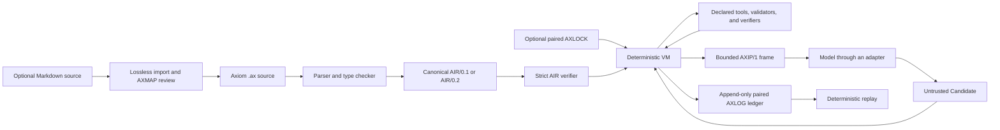

# Axiom

**A typed, proof-carrying execution language for AI agents.**

[](https://github.com/bilalxashraf/axiom/actions/workflows/ci.yml)
[](https://github.com/bilalxashraf/axiom/actions/workflows/security.yml)
[](LICENSE)

Axiom moves operational agent instructions out of repeatedly interpreted
Markdown and into checked `.ax` programs. The runtime—not the model—owns
control flow, tool authority, validation, evidence, obligation tracking, and
completion. Models are invoked only at explicit `infer` sites and their output
enters the program as an untrusted `Candidate<T>`.

The core invariant is:

> A task cannot complete successfully while any of its declared obligations
> remains unresolved.

That is a deliberately precise claim. Axiom can prevent the silent omission of
an instruction that has been formalized as an obligation. It cannot make an
LLM deterministic, make an impossible task succeed, prove that a verifier
captures human intent, or turn a host process into a security sandbox.

## Status

| Component | Current version or status |
| --- | --- |
| Reference package | `@axiom-lang/core` **0.3.0** |
| Source language | **Axiom Core 0.1 and 0.2** (`axiom 0.1;` / `axiom 0.2;`) |
| Executable IR | `AIR/0.1` and `AIR/0.2` |
| Model protocol | `AXIP/1` |
| Lock, ledger, and Markdown map | `AXLOCK/0.1`/`0.2`, `AXLOG/0.1`/`0.2`, `AXMAP/0.1` |
| Runtime | TypeScript on Node.js 24+ |
| Maturity | Alpha research preview |
| License | Apache-2.0 |

The package and language versions are intentionally different. `0.3.0` is the
TypeScript toolchain release. It retains frozen Core 0.1 support and adds the
separately versioned Core 0.2 control profile and paired interoperability
formats.

This repository is suitable for evaluation, language design, conformance
work, deterministic fixtures, and controlled experiments. It is not yet a
production security boundary or an AGI mechanism.

## Why Axiom

An agent instruction file often mixes requirements, background, examples,
preferences, permissions, and completion criteria in one prose document. A
model must reinterpret that mixture on every call, and a conventional harness
must separately decide what the model may do and whether the task is finished.

Axiom gives those concerns executable forms:

| Problem | Axiom mechanism |
| --- | --- |
| Required work can be forgotten | Named `must` obligations block `complete` |
| Model output may be malformed or unsafe | `Candidate<T>` is unusable until a trusted `validator` narrows it |
| Prompts implicitly grant tool authority | Only declared ports can be called at typed operation sites |
| Writes may be duplicated | Every `act` has a domain-separated idempotency key |
| “Done” is a subjective model judgment | Trusted `verifier` evidence is consumed by `satisfy` |
| Prose conditionals can be skipped or reinterpreted | The VM owns exhaustive typed `if` control |
| “Repeat until done” can run forever | `repeat max N` is post-test, recorded, and statically bounded |
| Runs are difficult to reproduce | Canonical AIR, locks, append-only ledgers, and replay |
| Markdown migration can silently drop prose | Lossless import, explicit span disposition, and a source-wide review seal |
| Full instruction files consume context repeatedly | Bounded, node-local AXIP frames instead of the full source |

Markdown remains useful for documentation. Axiom targets the part that governs
execution.

## Quick start

The reference implementation requires Node.js 24 or newer. From a checkout:

```sh
npm ci --ignore-scripts
npm run check
```

The complete fixture-backed demo is offline after dependencies are installed:

```sh
node dist/src/cli.js check examples/fix.ax

node dist/src/cli.js lock examples/fix.ax \
  -o axiom.lock \
  --fixtures examples/fixtures.json

node dist/src/cli.js run examples/fix.ax \
  --task Fix \
  --input examples/input.json \
  --fixtures examples/fixtures.json \
  --lock axiom.lock \
  --ledger run.axlog

node dist/src/cli.js replay examples/fix.ax \
  --task Fix \
  --input examples/input.json \
  --ledger run.axlog
```

Use `npm link` to expose the local `axiom` binary, or keep using
`node dist/src/cli.js`.

## The language at a glance

This runnable example inspects an issue, asks a model for a patch proposal,
validates it, applies it, runs tests, proves the declared obligations, and only
then completes:

```axiom
axiom 0.1;

record Issue {
  summary: Text;
  terms: List<Text>;
}

record Facts {
  files: List<Text>;
}

record PlannerInput {
  issue: Issue;
  facts: Facts;
}

record Plan {
  file: Text;
  patch: Text;
}

record Receipt {
  changed: Bool;
}

record TestResult {
  exit_code: Int;
}

record FixResult {
  receipt: Receipt;
}

proposition Inspected event;
proposition Applied event;
proposition TestsPass state;

extern tool inspect(issue: Issue) -> Facts mode read;
extern tool apply(plan: Plan) -> Receipt mode write;
extern tool test(input: Unit) -> TestResult mode read;

extern model planner(input: PlannerInput) -> Plan
  intent "Choose one relevant file and propose the smallest patch.";

extern validator safe_plan(raw: Candidate<Plan>, facts: Facts) -> Plan;

extern verifier nonempty(facts: Facts) proves Inspected;
extern verifier changed(receipt: Receipt) proves Applied;
extern verifier exit_zero(result: TestResult) proves TestsPass;

task Fix(issue: Issue) -> FixResult
must {
  inspected: Inspected;
  applied: Applied;
  tests: TestsPass;
}
{
  observe facts = inspect(issue);
  verify inspection_evidence = nonempty(facts);
  satisfy inspected with inspection_evidence;

  infer raw_plan = planner(PlannerInput {
    issue: issue,
    facts: facts,
  }) limit input_bytes 16384 output_bytes 4096 attempts 2;

  validate plan = safe_plan(raw_plan, facts);
  act receipt = apply(plan) key hash(plan);

  verify applied_evidence = changed(receipt);
  satisfy applied with applied_evidence;

  observe test_result = test(unit);
  verify test_evidence = exit_zero(test_result);
  satisfy tests with test_evidence;

  complete FixResult { receipt: receipt };
}
```

The model cannot call `inspect`, `apply`, or `test`. It cannot mint evidence,
satisfy an obligation, or complete the task. It can only return a candidate
for the declared `Plan` schema. The trusted `safe_plan` validator must convert
that candidate into an ordinary `Plan` before the write port can consume it.

The same program, deterministic input, and fixture bindings are in
[`examples/`](examples).

Core 0.2 makes control executable without handing it to the model:

```axiom
axiom 0.2;

extern tool poll() -> Bool mode read;
extern tool ready_path() -> Unit mode read;
extern tool fallback_path() -> Unit mode read;

task Wait(prefer_ready: Bool) -> Unit must {} {
  if prefer_ready then {
    observe selected = ready_path();
  } else {
    observe fallback = fallback_path();
  }

  repeat max 8 {
    observe done = poll();
  } until done;

  complete unit;
}
```

Only the selected branch executes. The repeat body runs once before testing,
uses a fresh local frame on each iteration, and fails with `AX2140` if its
eighth observed result is still false. Branch and loop locals cannot be used
after their blocks. A selected `if` branch may end in `fail`; `complete`
remains a top-level task terminal, and repeats cannot contain either terminal.

### Core declarations and operations

| Form | Role |
| --- | --- |
| `record` | Declares closed, JSON-shaped data |
| `proposition ... event/state` | Names a claim that trusted code may establish |
| `extern tool` | Declares a typed read or write boundary |
| `extern model` | Declares an explicit nondeterministic inference boundary |
| `extern validator` | Narrows `Candidate<T>` into trusted program data |
| `extern verifier` | Produces proposition-specific evidence |
| `task ... must` | Declares a finite workflow and mandatory obligations |
| `observe` | Calls a read-only tool |
| `infer` | Calls a model under byte and attempt limits |
| `validate` | Sends a candidate to a declared validator |
| `act` | Calls a write tool with an idempotency key |
| `verify` | Asks a verifier to establish a proposition |
| `satisfy` | Consumes matching evidence and resolves one obligation |
| `complete` | Succeeds only when every obligation is currently satisfied |
| `assert` / `fail` | Terminates unsuccessfully when a condition or task fails |
| `if ... then ... else ...` | Selects exactly one checked branch from a validated `Bool` |
| `repeat max N { ... } until ...` | Repeats an effect-bearing block at most `N` times |

Core 0.1 remains the frozen linear profile. Core 0.2 adds exhaustive
conditionals and bounded post-test repeats while retaining one source-ordered
execution and one top-level terminal. It still has no recursion, concurrency,
dynamic evaluation, unbounded loop, or dynamic task generation. See
[`docs/LANGUAGE.md`](docs/LANGUAGE.md), the frozen Core 0.1
[`spec/grammar.ebnf`](spec/grammar.ebnf), and the Core 0.2
[`spec/grammar-0.2.ebnf`](spec/grammar-0.2.ebnf).

## Architecture and execution



The execution path is:

1. The checker parses source, checks types and port modes, confines candidate
   values, and proves that completion cannot bypass obligation resolution.
2. The compiler emits the edition-paired canonical AIR and separate semantic
   and artifact hashes.
3. A strict AIR verifier independently re-establishes the runtime safety
   invariants before AIR is admitted.
4. An optional edition-paired AXLOCK freezes formats, hashes, exact port signatures,
   inferred least-authority port sets, static bounds, and an optional trusted
   binding fingerprint.
5. The VM evaluates immutable bindings and operations in source order; under
   Core 0.2 it also owns typed branch selection and bounded repetition.
6. Every model, tool, validator, and verifier call occurs at a declared effect
   site. Durable execution records intent before dispatch and outcome after.
7. `complete` succeeds only after each obligation has consumed matching,
   verifier-minted evidence.
8. Replay substitutes recorded outcomes and checks the same effect requests,
   obligation transitions, Core 0.2 control trace, and terminal result without
   live calls.

The runtime is a standardized static harness generated from the program. Axiom
does not eliminate the need for a runtime, model adapter, durable store, or
host security boundary; it makes their responsibilities explicit and smaller.

## What “deterministic” means

Axiom separates four commonly conflated properties:

| Level | Property | Core 0.1 / 0.2 |
| --- | --- | --- |
| **D1 — Artifact determinism** | Same accepted source, verified sidecars, and pinned toolchain produce byte-identical canonical AIR and hashes | Guaranteed under the documented trust assumptions |
| **D2 — Control determinism** | Same verified AIR, input, policy, and ordered external outcomes produce the same state transitions and terminal result | Guaranteed under the documented trust assumptions |
| **D3 — Replay determinism** | Same program, input, run identity, and complete valid ledger reproduce the recorded execution without live effects | Guaranteed under the documented trust assumptions |
| **D4 — Live-world reproducibility** | Separate live runs return the same model output, observations, timing, and receipts | **Not guaranteed** |

The defensible summary is:

> Axiom makes program control, authority checks, obligation accounting, and
> replay deterministic. It exposes model and external-world variation as
> typed, bounded, recorded outcomes.

Two live calls to the same model may still differ. Different models may
produce different candidates. A service, file, user, or database may change
between observations. Temperature zero and a seed are operational controls,
not proofs of live reproducibility.

Comments and formatting may change source provenance and the exact AIR
artifact hash while preserving the domain-separated semantic hash. Given the
same semantic program, task input, runtime policy, run identity, and recorded
external outcomes, replay follows the same checked transition sequence.

Read the complete conditions in
[`docs/GUARANTEES.md`](docs/GUARANTEES.md).

## Guarantees and non-guarantees

### Core 0.1 and 0.2 enforce

- Successful completion requires every declared obligation to be satisfied.
- Evidence is nominal, proposition-specific, and consumed linearly.
- A satisfied `state` obligation is invalidated after a later `act`; an
  `event` obligation remains satisfied.
- Model output remains `Candidate<T>` and may flow only to a declared
  validator as its top-level candidate argument.
- Only declared ports can be invoked, with checked arguments, result types,
  read/write modes, and operation kinds.
- Every write carries a stable identity derived from the semantic program,
  task, input, operation site, user key, and argument hash.
- Inference input bytes, output bytes, and attempts are finite and enforced.
- Canonical data, AIR, protocol frames, locks, and ledger entries have strict
  versioned forms.
- Locked execution fails before dispatch when the program or trusted binding
  set does not exactly match.
- Replay rejects missing, extra, reordered, or mismatched external effects.
- Core 0.2 branch predicates are exact validated Booleans, only one branch
  executes, and branch decisions are recorded.
- Core 0.2 repeats run at most 1,024 iterations, have recursive static bounds,
  use iteration-specific effect identities, and fail closed on exhaustion.

### Neither profile guarantees

- identical output from independent live model calls;
- that every model is capable of producing the required candidate;
- correctness, honesty, isolation, or completeness of trusted validators,
  verifiers, tools, and adapters;
- operating-system, filesystem, network, secret, approval, identity, or
  monetary isolation;
- exactly-once remote writes unless the host persistently deduplicates Axiom's
  idempotency key;
- that a timed-out write did not commit remotely;
- ledger authenticity when an attacker can replace the ledger and its
  unanchored hash-chain root;
- automatic semantic equivalence between Markdown prose and an Axiom program;
- a minimum token count or universal token-savings percentage; or
- AGI, task success, truth, safety, or alignment merely because a program uses
  Axiom.

The trusted computing base and residual risks are detailed in
[`docs/THREAT-MODEL.md`](docs/THREAT-MODEL.md).

## CLI

After `npm run build`, use `node dist/src/cli.js`; after `npm link`, use
`axiom`.

| Command | Purpose |
| --- | --- |
| `import-md` | Create a lossless migration draft and `AXMAP/0.1` sidecar |
| `check` | Parse, type-check, and prove obligation-flow safety |
| `compile` | Emit edition-paired canonical `AIR/0.1` or `AIR/0.2` JSON |
| `lock` | Freeze program facts, capabilities, bounds, and host bindings |
| `verify-lock` | Fail unless a program and binding set exactly match a lock |
| `run` | Execute with fixture-backed tools and a fixture or HTTP model |
| `replay` | Re-execute from a ledger without calling models or tools |
| `frame` | Run against fixtures and print each compact AXIP model frame |
| `conform` | Probe an HTTP model adapter for baseline AXIP/1 compatibility |

Common workflows:

```sh
# Check and compile
axiom check workflow.ax
axiom compile workflow.ax -o workflow.air

# Create and verify a lock
axiom lock workflow.ax -o axiom.lock \
  --fixtures bindings.json
axiom verify-lock workflow.ax --lock axiom.lock \
  --fixtures bindings.json

# Execute and retain a durable replay transcript
axiom run workflow.ax \
  --task TaskName \
  --input input.json \
  --fixtures bindings.json \
  --lock axiom.lock \
  --ledger run.axlog

# Re-run without any live external calls
axiom replay workflow.ax \
  --task TaskName \
  --input input.json \
  --ledger run.axlog \
  --output-ledger replay.axlog

# Inspect the exact model-boundary frames
axiom frame workflow.ax \
  --task TaskName \
  --input input.json \
  --fixtures bindings.json

# Check a direct AXIP endpoint
axiom conform \
  --adapter-url http://127.0.0.1:8080 \
  --timeout-ms 30000
```

Live model attempts and tool, validator, and verifier calls have 30-second
host deadlines by default. `run` and `frame` accept
`--inference-timeout-ms` and `--effect-timeout-ms`. Cancellation bounds the
host wait; it cannot undo an external write that already happened.

There is no implicit lock search. Omitting `--lock` is an explicit unlocked
alpha-mode execution.

## Library API

The package exports the compiler, strict AIR verifier, VM, adapters, protocol,
canonical data utilities, locks, ledger, Markdown importer, schemas, and
conformance probe:

```ts
import {
  compileSource,
  verifyAirProgram,
} from "@axiom-lang/core";

const compiled = compileSource(source, "workflow.ax");
verifyAirProgram(compiled.program);

console.log(compiled.hash);         // executable semantics
console.log(compiled.artifactHash); // exact canonical AIR artifact
```

Runtime hosts implement the small `RuntimeBindings` interface: one model
adapter plus typed tool, validator, and verifier calls. The reference package
ships `TextFunctionAdapter`, `HttpTextAdapter`, `FixtureAdapter`, and
`ReplayAdapter`.

## Migrating Markdown without silent loss

Any Markdown file can enter a lossless migration process:

```sh
axiom import-md AGENTS.md -o AGENTS.ax
```

This writes:

- `AGENTS.ax`, embedding the exact original bytes and declaring every
  nonblank span as explicitly unresolved; and
- `AGENTS.axmap.json`, an `AXMAP/0.1` coverage sidecar containing the source
  hash, byte length, exact base64 payload, span ranges, span hashes, and
  dispositions.

The draft parses, but strict compilation fails until a reviewer classifies
every nonblank span:

```axiom
resolved span_000001 source markdown_source bytes 0 17
  hash "sha256:0123..." as requirement
  task Fix obligation inspected
  reason "This span requires inspection before completion.";

resolved span_000002 source markdown_source bytes 17 61
  hash "sha256:4567..." as non_normative
  reason "This span is an explanatory example.";

review markdown_source
  source_hash "sha256:SOURCE_HASH"
  dispositions_hash "sha256:CANONICAL_DISPOSITIONS_HASH";
```

A `requirement` must link to an existing task obligation. A
`non_normative` disposition needs an explicit reason. The final source-wide
seal binds the entire imported document, every disposition, the linked
propositions, and the executable formal declarations. Source edits, moved
spans, changed dispositions, or changed formal semantics invalidate the
review.

This process proves exact byte retention, complete visible disposition, valid
links, and seal freshness. It does **not** prove that a reviewer mapped natural
language correctly or honestly. The importer never guesses away that
responsibility. See
[`docs/MARKDOWN-IMPORT.md`](docs/MARKDOWN-IMPORT.md).

## Token and context efficiency

Axiom source is compiled and executed; it is not copied into every model call.
At an `infer` site, the model receives one bounded, node-local AXIP frame
containing:

- stable protocol, program, run, and operation identities;
- the selected model port's `intent`;
- only the evaluated arguments declared by that port;
- closed input and output schemas;
- only record definitions reachable from those schemas;
- current pending or stale obligation identifiers;
- allowed response kinds and explicit budgets; and
- the fixed semantic-prologue reference.

The frame excludes the `.ax` source, Markdown provenance, unrelated task
bodies and records, comments, chat history, old model prose, and tool receipts
that are not explicit arguments.

Efficiency is portable because both profiles make UTF-8 bytes—not provider
tokens—normative:

```axiom
infer raw_plan = planner(input)
  limit input_bytes 16384 output_bytes 4096 attempts 2;
```

Different providers and model revisions tokenize the same text differently.
Axiom can enforce byte and attempt bounds everywhere; provider token counts
remain optional telemetry. Oversized frames and responses fail rather than
being silently truncated or summarized.

AXIP uses canonical compact JSON and a fixed, content-addressed prologue. An
adapter that has installed the exact current prologue may advertise its hash
and receive a reference instead of the inline bytes. In the frozen
`AXIOM-CONFORMANCE/0.1` fixture, that changes a 1,329-byte inline frame to a
543-byte referenced frame—a 59.1% transport-byte reduction for that fixture,
not a universal token-savings benchmark.

Current limitations matter:

- byte limits are per attempt, not one task-wide cost budget;
- a large explicit argument is sent whole rather than silently pruned;
- canonical JSON favors interoperability over maximum compression;
- the current profiles have no context store, chunker, or reference-expansion round;
- its current `contextRefs` list is empty, so `need_context` fails visibly;
  and
- live model output remains nondeterministic regardless of frame size.

See [`docs/TOKEN-EFFICIENCY.md`](docs/TOKEN-EFFICIENCY.md) for the accounting
model and reproducible benchmark method.

## Model portability

Axiom semantics do not depend on a vendor, SDK, tokenizer, chat role, native
tool-calling format, or structured-output feature. The model boundary is:

```text
normalized AXIP inference frame -> normalized inference outcome
```

A conforming adapter returns exactly one of:

- `candidate` — a value that must pass schema checking and validation;
- `need_context` — a request for declared content references; or
- `fail` — a structured refusal or inability to produce a candidate.

AXIP/1 defines all three. The current VM accepts `candidate` and
`fail`; because it supplies no context references, `need_context` fails rather
than triggering undeclared retrieval.

The minimum model profile is finite text input and finite text output through
an adapter. Native structured output may improve reliability, but it cannot
change obligations, authority, budgets, or completion rules. Native tool
calling is unnecessary because models do not call tools in Axiom.

`checkAdapterConformance(adapter)` and `axiom conform` provide a bounded
protocol probe for framing, typed output, identity echoing, budgets, and nonce
preservation. Passing the probe establishes baseline AXIP compatibility—not
reasoning quality, model determinism, validator soundness, or workload safety.

See [`docs/MODEL-INDEPENDENCE.md`](docs/MODEL-INDEPENDENCE.md).

## Locks, ledgers, and replay

The edition-paired `AXLOCK/0.1` or `AXLOCK/0.2` freezes:

- language, AIR, protocol, and toolchain profiles;
- semantic and artifact program hashes;
- exact port signatures and task port sets;
- static operation, effect, attempt, and write bounds; and
- an optional fingerprint for the exact trusted binding implementation set.

Lock verification reconstructs and compares the whole object. `run --lock`
and `frame --lock` reject a mismatch before any tool call or model frame is
dispatched.

`run --ledger` creates a new append-only, fsynced write-ahead ledger. External
effect intent is recorded before dispatch and its outcome afterward. An intent
without an outcome is visibly uncertain. A caught write failure is also marked
uncertain because a timeout or transport error cannot prove that the remote
system did not commit.

Each execution requires an empty output ledger and holds its exclusive writer
until the terminal entry is appended. Concurrent caller appends, publication,
or close attempts are rejected, and no entry may be appended after `success`
or `failure`. This preserves effect-intent/outcome adjacency across awaited
host calls.

Ledger entries form a canonical hash chain. Replay validates the chain,
program, input, run header, each normalized request and response, obligation
transitions, and the terminal payload. AXLOG/0.2 control entries include the
complete active iteration vector, and replay authenticates the full ordered
effect/control/obligation transcript. Replay makes no model, tool, validator,
or verifier calls.

A hash chain detects mutation relative to a trusted root; it is not by itself
a signature, MAC, remote timestamp, or transparency log.

## Dynamic harnesses

Core 0.1 and 0.2 are language-defined **static** harnesses: finite,
source-ordered, typed, locked, verified, and replayable. Core 0.2 adds
sequential branch and bounded-repeat control; the host still provides a
runtime and explicit external bindings.

Model-proposed dynamic task graphs are **planned, not implemented or
certified**. The proposed safety pipeline is:

```text
Candidate<TaskGraphProposal>
  -> validate
  -> compile to canonical graph IR
  -> independently verify
  -> admit through deployment policy
  -> execute a sealed bounded graph
```

The design requires finite graphs, typed edges, bounded fan-out and retries,
capability attenuation, hierarchical budgets, deterministic joins, explicit
failure paths, proof-flow rules, and replayable scheduling. A model proposal
would remain data and could never be executed directly.

The goal is not “no harness.” Every agent system has one. The goal is to move
harness policy into a typed, versioned, auditable language and reduce the
remaining host to a small runtime plus adapters. See
[`docs/DYNAMIC-HARNESSES.md`](docs/DYNAMIC-HARNESSES.md).

## Development and verification

The package has no runtime dependencies. The main local checks are:

| Command | Check |
| --- | --- |
| `npm run check` | Repository metadata, TypeScript, build, and complete tests |
| `npm run typecheck` | Type-check without emitting files |
| `npm run build` | Compile source and tests to `dist/` |
| `npm test` | Rebuild and run all compiled tests |
| `npm run test:determinism` | Run the focused determinism suite |
| `npm run coverage` | Enforce 78% line, 75% branch, and 85% function floors |
| `npm run package:verify` | Prove two packs are byte-identical, install one, and smoke-test API and CLI |
| `npm run repo:check` | Validate required artifacts, links, versions, and pinned actions |
| `npm run vectors:generate` | Print—but never overwrite—the current conformance-vector candidate |

For a larger deterministic property and mutation corpus:

```sh
AXIOM_PROPERTY_CASES=20000 AXIOM_FUZZ_CASES=25000 npm test
```

GitHub Actions includes:

- a push and pull-request matrix across Ubuntu, macOS, Windows, Node 24, and
  Node 26;
- a scheduled determinism matrix across operating systems, locales, and time
  zones with the larger property and fuzz corpus;
- dependency review, CodeQL, and npm audit security checks; and
- a tag-triggered release-artifact workflow that verifies reproducible
  archives, smoke-installs the retained archive, checks the tag against
  `package.json`, attests provenance, and uploads the artifact.

The release workflow does not publish to npm or create a GitHub Release
automatically.

## Road to 1.0

Implemented in this research preview:

- parser, type checker, canonical compiler, and strict AIR verifier;
- obligations, nominal propositions, linear evidence, and state invalidation;
- candidate confinement and declared external ports;
- exhaustive typed conditionals, bounded effect-bearing repeats, recursive
  control-flow admission bounds, and replayed control traces;
- AXIP model framing, adapters, byte budgets, attempts, and host deadlines;
- lockfiles, binding fingerprints, write-ahead ledgers, and replay;
- lossless, fail-closed Markdown migration;
- conformance vectors, deterministic property tests, seeded fuzz tests,
  coverage floors, and CI workflows.

Important work before a production 1.0 claim includes scoped unforgeable
capabilities, richer `Result`/`Option` and exhaustive matching, effect regions,
content-addressed dependency imports, transaction semantics, an independent
verifier implementation, stronger ledger-root anchoring, bounded dynamic task
graphs, multiple independent implementations, provider qualification, and
external security review.

The full gates are tracked in [`ROADMAP.md`](ROADMAP.md).

## Documentation map

### Start here

- [`docs/LANGUAGE.md`](docs/LANGUAGE.md) — Core 0.1 and 0.2 language and semantics
- [`docs/GUARANTEES.md`](docs/GUARANTEES.md) — exact determinism boundary
- [`docs/PROTOCOL.md`](docs/PROTOCOL.md) — AXIP model protocol
- [`examples/`](examples) — runnable fixture-backed workflow

### Migration, portability, and efficiency

- [`docs/MARKDOWN-IMPORT.md`](docs/MARKDOWN-IMPORT.md) — lossless,
  review-required Markdown migration
- [`docs/MODEL-INDEPENDENCE.md`](docs/MODEL-INDEPENDENCE.md) — adapter and
  portability contract
- [`docs/TOKEN-EFFICIENCY.md`](docs/TOKEN-EFFICIENCY.md) — byte budgets,
  frames, measurements, and benchmark method

### Reproducibility and interoperability

- [`docs/LOCKFILES.md`](docs/LOCKFILES.md) — lockfile contents and admission
- [`docs/COMPATIBILITY.md`](docs/COMPATIBILITY.md) — versioned compatibility
  boundaries
- [`docs/CONFORMANCE.md`](docs/CONFORMANCE.md) — implementation, adapter, and
  release checks
- [`spec/conformance-vectors.json`](spec/conformance-vectors.json) — frozen
  canonical vectors
- [`spec/semantics.md`](spec/semantics.md) — formal operational semantics
- [`spec/canonical-json.md`](spec/canonical-json.md) — canonical data rules
- [`spec/axlock.md`](spec/axlock.md) and [`spec/axlog.md`](spec/axlog.md) —
  lock and ledger formats

### Design, safety, and release

- [`docs/DESIGN-SYNTHESIS.md`](docs/DESIGN-SYNTHESIS.md) — lessons taken from
  Go, Rust, Java, Kotlin, C++, Starlark, CUE, and Rego
- [`docs/DYNAMIC-HARNESSES.md`](docs/DYNAMIC-HARNESSES.md) — planned bounded
  dynamic task-graph profile
- [`docs/THREAT-MODEL.md`](docs/THREAT-MODEL.md) — trust assumptions and
  residual risks
- [`docs/LAUNCH.md`](docs/LAUNCH.md) — research-preview release checklist

## Contributing

Axiom changes are spec-first and fail-closed. Language or protocol changes
must keep the grammar, checker, AIR, strict verifier, runtime, canonical
encoding, negative tests, replay behavior, and compatibility story aligned.
See [`CONTRIBUTING.md`](CONTRIBUTING.md).

Please report security issues privately according to
[`SECURITY.md`](SECURITY.md). Do not publish exploits, secrets, unsafe binding
details, or vulnerable production endpoints in a public issue.

## License

Apache License 2.0. See [`LICENSE`](LICENSE).
